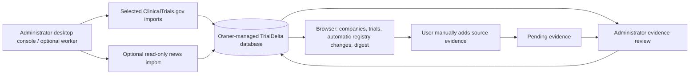

This app is now hosted at trialdelta-derekjones.duckdns.org. This repo contains connectors to live data feeds that are not distributed by the hosted site during early development. There are snapshots of delayed data that allow browsing of the apps features at the hosted site.

# TrialDelta

A local-first research workspace for tracking **what changed** in healthcare companies and clinical programs across therapeutic areas. TrialDelta preserves the evidence behind a change and keeps registry milestones separate from company readout guidance.

**Stack:** Python 3.13, FastAPI, SQLAlchemy, MySQL or SQLite, a Tkinter administrator desktop app, and browser-native JavaScript/CSS. The application needs no frontend build step, paid API, or language-model service.

## Run locally

From this repository on Windows, open the administrator desktop app first. The launcher uses the existing `.venv`; on a fresh checkout, run the environment setup commands below before launching it:

```powershell
.\admin.ps1
```

The console initializes the database and company directory. Select companies and run a ClinicalTrials.gov import when you are ready to populate or update trial records. Opening the console does not start collection. Python must include Tkinter (included with the standard Windows Python installer).

Start the user-facing browser application separately:

```powershell
.\start.ps1
```

Open **http://127.0.0.1:8765**. The launcher creates a virtual environment when needed, starts the web app in a hidden process, and writes server logs under `data/`. Starting or browsing the web app does not seed company coverage, fetch registry data, or launch a collector. Users browse the records already imported into your configured database. To stop launcher-owned processes:

```powershell
.\stop.ps1
```

For a fresh checkout without the existing workstation database, copy `.env.example` to `.env`. SQLite works without database credentials. For explicit foreground commands on any supported platform:

```bash
python -m venv .venv
# Activate .venv, then:
python -m pip install -r requirements.lock
python -m trialdelta.admin_app
# Start the browser server separately:
python -m uvicorn trialdelta.app:app --host 127.0.0.1 --port 8765 --no-proxy-headers
```

The checked-out workstation configuration uses the `gptdb` account on local MySQL and the **existing `gptdb` environment variable for its password**. No password is copied into source or `.env`. `USE_LOCAL_MYSQL=true` selects this connection; `MYSQL_USER` defaults to `gptdb`, and `MYSQL_HOST` and `MYSQL_PORT` supply its host settings. Both the application and filings worker require this credential and never fall back to the root account's `DATABASE_PASSWORD`. A generic `DATABASE_URL` supports a separate host. MySQL startup refuses a database name other than `trialdelta`.

## Administrator data workflow

The Tkinter console connects directly to the same database configuration as the web server. Database credentials stay in your administrator environment and on the server; browser users access authenticated research endpoints rather than receiving database credentials.



Use the console to:

- View database totals such as **companies in coverage**, **trials captured**, snapshots, change log entries, pending company evidence, and source candidates.
- Select company coverage and run ClinicalTrials.gov retrieval for that selection or for all active companies. First collection establishes baselines; later collections preserve new snapshots and automatically display tracked registry differences.
- Use **Bulk download** to refresh Healthcare coverage from the market database, clean company sponsor names, and retrieve trials in batches with saved progress and cancellation/resume.
- Run the optional news import independently of registry collection. Inspect source candidates and the original primary source before recording evidence.
- Review optional submitted company evidence. Structured registry differences require no manual approval.
- Inspect collection history, per-company status, and background task output while imports run.

The console has **Collection**, **Bulk download**, **Target action dates**, **Review & publish**, **Source inbox**, and **Run history** tabs. Use Ctrl/Shift to select multiple companies. Its activity log shows output for the current session; registry run history is stored in `td_jobs` and the latest 100 jobs are displayed. News-import output is session-only. Source candidates can be opened or dismissed in the console; record any supported claim through the browser's **Add evidence** form.

### Bulk healthcare download

The external market-data updater should publish complete classification snapshots atomically (for example, commit its updates together). TrialDelta treats absence from the successfully read source table as delisting. Empty or malformed sources are rejected, but a nonempty table observed midway through a rebuild cannot be distinguished from actual removals.

Open **Bulk download** in the administrator console. Before each new download, TrialDelta reads the full `stocks.symbol_sector_industry` table and synchronizes its covered companies to the **Healthcare** sector. The same refresh runs before each automated worker collection. It uses `SOURCE_DATABASE_URL` when configured, otherwise the configured TrialDelta MySQL connection (including the `USE_LOCAL_MYSQL=true` convention); the source account needs **SELECT** permission on `stocks.symbol_sector_industry`. TrialDelta never writes to that table. The original 25-company seed directory is not a coverage limit.

Company names remain externally maintained. TrialDelta reads the ticker-to-name JSON dictionary at `E:\Market Research\Dataset\Fundamental Data\company_names.txt`, for example `{"ARVN": "ARVINAS INC"}`. Set `HEALTHCARE_COMPANY_NAMES_PATH` to its location on another workstation or host. Keep this dataset current through your market-data package; TrialDelta does not add an online symbol-to-name fallback. Classification files are no longer the source of regular market coverage synchronization.

**Refresh healthcare company list** performs synchronization without collecting trials and reports additions, updates, reactivations, delistings, and companies moved outside Healthcare. A symbol removed from the entire source table is tagged **Delisted**; a symbol still present in a different sector is tagged **Outside Healthcare**. Both statuses stop new routine collection while keeping all company records, trials, snapshots, changes, and follows available. A symbol returning to Healthcare is reactivated. These tags reflect the latest successful refresh, not a continuously synchronized listing feed.

Missing or malformed source data does not retire coverage. If the automatic refresh fails, collection continues with the previously active list and records a warning in the run history. Bulk-download warnings also appear in the administrator session log; worker warnings are written to its process output. A manual company-list refresh reports the failure. A missing name for a new symbol continues to use the existing skip behavior; saved sponsor mappings and history are retained.

Name cleaning adapts both `utilities.clean_company_names` and the corporate suffix normalization in `clinical_trials.py`. It preserves names without suffixes, removes suffixes only at the end, handles stacked and dotted legal suffixes, and normalizes ampersands consistently on both reference and registry names. Multiple tickers resolving to one sponsor are skipped rather than assigned arbitrarily. Matching uses the cleaned **lead sponsor** name; collaborator-only, fuzzy, and unmatched subsidiary hits are excluded. No automatic fuzzy ticker assignment is used.

Choose **Start bulk download** to refresh the healthcare universe and retrieve all conditions and study types for active companies. Optional **Updated since** and **Updated through** dates filter each trial's latest registry update date, including both endpoints. Enter dates as `YYYY-MM-DD`; leave the start blank for any earlier date, the end blank for updates through the present, or both blank for an initial import. Use the same date in both fields for a single day. For example, if you already have updates from September 25 onward, use **Updated since** `2026-09-01` and **Updated through** `2026-09-24` to fill the earlier interval without reprocessing later updates. The dashboard rejects invalid dates, future dates, and reversed ranges before starting. Date ranges select current trial records by their latest update date; they do not retrieve historical versions or every update event in that period. **Healthcare companies (market coverage)** and **All active companies** both use the refreshed active directory. **Selected in Collection tab** refreshes coverage and then limits collection to the selected companies that are still active. The ordinary **Collection** tab uses saved active coverage; the scheduled worker refreshes coverage before collection. Both retrieve all conditions and study types.

The downloader adapts [Healthcare_Data clinical_trials.py](https://github.com/jdejones/Healthcare_Data/blob/main/clinical_trials.py): up to 100 sponsor names per search and 1,000 records per page, following every `nextPageToken`, including tokens on empty pages. It spaces requests and retries temporary HTTP/connection failures with bounded backoff and `Retry-After` support. Each page saves raw snapshots, normalized trial data, automatic changes, and its checkpoint in one transaction. The current page rolls back on a data/database error; earlier saved pages remain available. Identical snapshots are not duplicated, and first captures create no change alerts.

MySQL stores raw and normalized snapshots and before/after comparison values as `LONGTEXT`, including large primary-outcome descriptions. Startup widens older evidence columns while holding the collection lock, preserving their content, encoding, and nullability. Bulk failures retain a safe explanation in the completion summary and when selecting a saved run in either history view. A `partial` run with zero saved pages explicitly says it stopped before saving any pages; its checkpoint can still be resumed after the cause is corrected.

**Cancel** stops at a safe page boundary. Select a cancelled, partial, or interrupted run and choose **Resume selected run** to continue its saved scope and filters, including both date boundaries. Resume ignores the current form fields and does not refresh coverage or change its saved company scope, even if a company has since become inactive. Saved progress uses the additive `td_bulk_checkpoints` table, created at administrator startup, and survives app restarts. The existing collection lock prevents overlapping collectors. A changed company scope or a registry cursor that has expired requires a fresh run; reprocessing records preserves snapshot idempotence. Older saved runs without an end date continue through the present. Legacy oncology-filtered checkpoints retain their original query when resumed; start a fresh run to expand their scope. A date-filtered or legacy oncology-filtered run does not mark a company as fully refreshed. The latest 100 bulk runs show the saved date range, pages, scanned records, processed trials, skipped matches, and differences; counts describe processed records, not just newly created trials.

Ordinary collection follows registry pagination to completion, including empty pages that carry a next-page token, and rejects invalid or repeated cursors without partially replacing a company's saved data. Names from all intervention types, including devices, procedures, behavioral interventions, and drugs, are indexed for search and theme follows. Observational studies can have no phase or intervention; this does not exclude them. See [the specialty-scope audit](deploy/SPECIALTY_SCOPE_AUDIT.md) for the paths checked and remaining coverage and capacity limits.

In local mode, the console trusts the operating-system account and attributes reviews to `local@trialdelta.local`. In hosted mode, sign in with an existing TrialDelta administrator email and password. Reader credentials cannot operate the console.

The console is an administrator tool for a trusted desktop with database access. It is not served over HTTP and requires no running web server. For a remote hosted database, configure the console to use that same database through an appropriately restricted connection; a local SQLite file is a different database from a server's SQLite volume. On a headless server, use the explicit worker commands below instead of Tkinter.

Collection, source-inbox management, job history, and database-wide metrics are absent from the browser API and UI, including for the local administrator. The compatibility review API remains administrator-only. Reader accounts cannot approve or reject evidence.

### Target action dates from stored SEC filings

News_Tracker's filings-stream GUI can now recognize dates automatically after each
biotechnology filing is saved. It launches a new `trialdelta.tad_worker --once`
process for that filing, hands off the already downloaded HTML and metadata, and
uses the same single-filing extraction/persistence routine as the manual import.
The process saves results and exits. News_Tracker limits concurrency to one child,
queues additional filings, and ends its dispatcher when the queue is empty. No
recognition process starts merely because the all-stock stream starts, and there
is no idle polling or automatic history scan. The worker
requires an explicit `mysql+pymysql` connection to the `trialdelta` database; it
refuses SQLite fallback or another database name. The worker processes only its
supplied filing and needs no source database connection. The separate `--check`
option validates destination/source access with SELECTs only and does not create
tables or import results. An explicit `--once` or `--check` mode is required.

Automatic processing uses the additive `td_tad_filing_jobs` table for pending,
failed, and completed filing snapshots. The worker creates only that table;
initialize the app's saved-date tables through the backend first. Date results and
successful completion are committed together per filing. Failed/interrupted work
leaves the source filing available for **Import stored filings** in the backend;
there are no automatic retries or recovery scans. Other pending or legacy retry
records are never processed by a new filing's worker. Completed snapshots,
including those with no matching phrase, skip parsing on repeated delivery. A
changed HTML snapshot is eligible again. Automatic recognition does not require
the backend window to be open. Existing receipt data is retained.

Unidentifiable and ambiguous mentions are saved for manual completion, with the
same excerpts and source metadata as a manual import. Use **Refresh saved dates**
in the administrator console, choose **Show → Unresolved**, select a record, then
**Edit selected** to supply a date. This view queries unresolved mentions directly,
so they remain accessible even when the default list reaches its 500-row limit.
These corrections survive automatic processing and manual
reimports. **Add date** still handles dates absent from the parser's exact wording.
The browser's **Refresh dates** reloads new results and corrections. Automatic
processing retains the parser's current recognition limits and does not resolve
which reported deadline is currently effective across different filings.

Open **Target action dates** in the administrator console and select **Import stored filings**. The importer reads `symbol`, `form_type`, the stored HTML `filing`, `accession_no`, `filed_at`, and `filing_link` from `filings.biotech_filings`. It uses `SOURCE_DATABASE_URL` when configured, otherwise the existing local MySQL connection. The source connection needs SELECT permission on that table. It does not call sec-api.io or an AI service. Starting the application or browsing dates does not trigger an import.

The desktop table includes the **Accession number** of the filing represented by each row's evidence; an em dash indicates no accession was supplied. Click any column heading to sort the displayed rows, then click again to reverse the order. The arrow marks the active sort, which is retained when refreshing or changing the Show filter. Reported dates sort chronologically, source counts sort numerically, and missing dates or accession numbers stay last in either direction.

To enter a date yourself, select **Add date** in the same administrator tab. Enter a ticker and a date as `YYYY-MM-DD`, or `YYYY-MM` when only the month and year are known. A source link and notes are optional. Select **Save date** to add it to the saved date list and calendar; use **Refresh dates** in the website to reload the results. Manual entries are labeled separately from filing extractions and retain the administrator's ID internally for attribution. Saving the same ticker, date, source link, and notes again does not duplicate the entry. Manual entry does not change the stored SEC filings or overwrite imported matches, and it is unavailable through the browser API. Existing databases receive the additive entry-origin and administrator columns when the app starts.

To remove a saved date, select its row and choose **Delete selected**, then confirm the ticker/date and scope. An identified row represents all saved manual and filing records with that ticker, date, and precision; deleting it removes that entire group. Deleting an unresolved row removes only that selected record. The administrator list refreshes after deletion; use **Refresh dates** on the website to update the date list and calendar. Deletion does not alter the original filings, so a later import can recreate filing-derived records. This action is available only in the administrator app.

To change a date, select its row and choose **Edit selected**. The form fills in the ticker, date, source link, and notes or excerpt; an unresolved date starts with a blank date field. **Save changes** validates the edited values and records corrections separately for the saved records represented by that row. Every original record and prior correction is retained. Saving unchanged values creates no correction. Stale selections are rejected, and the latest correction supplies the values shown in the administrator list and calendar. The evidence view includes the original date and excerpt. Corrections live in the additive `trialdelta.td_target_action_date_edits` table and survive later filing imports; deleting a saved result does not remove its correction history. Use **Refresh dates** on the website after saving.

The extraction adapts the plain-text and context helpers in [Healthcare_Data's TAD updater](https://github.com/jdejones/Healthcare_Data/blob/main/scripts/update_tad_calendar.py). It removes script/style/noscript content, keeps spaces between HTML text nodes, normalizes whitespace, and searches only for **target action date** or **target action dates**, ignoring capitalization. It first checks 100 characters before and after each phrase. If that check yields only unidentifiable results, it retries within the same sentence using the same date-association and validation rules, and saves that sentence as the evidence. Sentence boundaries account for date punctuation and common filing abbreviations. Explicit date expressions are recognized with fixed rules for named/abbreviated/numeric months, calendar component order, ordinal days, and coordinated date lists. Calendar validation is deterministic and does not use today's date to fill gaps.

A complete date is stored as `YYYY-MM-DD`; a reported month and year remains `YYYY-MM` with month precision. Missing years, invalid dates, ambiguous numeric day/month order, and phrases without an identifiable associated date after the sentence check are stored as unresolved results with the excerpt and explanation. The parser never substitutes the first or last day of a month. A source expression crossing the initial context boundary can be recovered by the sentence check. Existing identified or ambiguous results from the first check are retained. Identified dates are automatically available to readers; these results do not enter the manually submitted company-evidence review queue.

Results are stored in the additive `trialdelta.td_target_action_dates` table. Each result retains its symbol, form type, accession number, filing timestamp and link when supplied, filing content hash, normalized-text offsets, excerpt, matched expression, precision, recognition status, and import timestamp. Filing and import timestamps remain distinct from the reported target action date; neither supplies missing date components. Repeating an import does not duplicate saved occurrences; display groups identified ticker/date pairs and counts their source filings. A failed import rolls back its new results and preserves prior successful imports. An empty source reports zero scanned filings and leaves saved results intact. Changing or removing a source row does not automatically withdraw previously reported dates.

In the browser, open **Home → Target action dates** to browse up to 500 saved results, search, page through them, inspect their source excerpts, and open available filing links. Dates are ordered latest first, followed by unresolved results. These are reported dates and are not asserted to be the currently effective deadline across all filings. **Refresh dates** reloads saved results only. The desktop tab separately shows saved totals, import outcomes, and an **Open filing** action. No filing download or database-write endpoint is exposed to browser users.

The **Calendar** tab next to **8-Ks** presents those same saved results in a monthly calendar. Use the previous/next controls or **This month**, and select a ticker to inspect its filing evidence. Exact dates appear on their reported days; month-only dates appear in a separate section without acquiring a day. Unresolved mentions are listed below the calendar. Search filters the saved results before they are placed on the calendar. The calendar and date list share the same saved-data response and **Refresh dates** action.

After initializing the app database, the explicit administrator command is:

```bash
python -m trialdelta.tad
```

## Use the product

**Home** is the landing page, also reached from the sidebar and TrialDelta logo. Its **Trials** tab opens by default and lists the latest 100 imported trials by their first captured snapshot, newest first; refreshing an older trial does not make it newly added. **News** shows the latest stored headlines for biotechnology companies. **Target action dates** shows saved dates and unresolved filing excerpts from the administrator's TAD import. These feeds display 10 cards per page, with numbered pages and Previous/Next controls below the cards. Search filters the feed before pagination and returns to the first page.

**8-Ks** reads saved Form 8-K records from `filings.biotech_filings`, ordered by `filed_at` newest first, with undated filings last. The **Filings per page** dropdown offers 10 (the default), 25, 50, or 100 filings, with numbered pages and Previous/Next controls below the cards. Only the selected page of filing metadata is fetched; the browser does not download the complete filing collection or stored HTML. Each card shows the ticker, company when known, filing date, accession number, and an available source link. Search matches tickers, known company names, or accession numbers before pagination. Changing the search or page size returns to page one. This read-only feed uses `SOURCE_DATABASE_URL` when configured, otherwise the local MySQL connection when `USE_LOCAL_MYSQL=true`; it needs SELECT access to the source table. Other forms, including amendments labeled `8-K/A`, are excluded.

1. **Coverage:** browse imported companies and trials, then follow a company, an NCT trial, a drug/intervention, a curated target, or an exact registry indication. Each hosted account has an independent watchlist.
2. **Add evidence:** manually submit a primary-source URL, publication date, exact excerpt, title/page reference, and supported claim. Reader submissions remain pending until an administrator reviews them. Opening a linked ClinicalTrials.gov page does not trigger a bulk import.
3. **View evidence:** compare previous/current snapshots or approved quoted statements, open original sources, and download preserved registry JSON.
4. **Change log:** see changes for your followed companies and trials by default, newest first, with 10 changes per page. Turn off **Following only** to browse all tracked changes. Category, search, and follow filters apply before pagination and return to page 1 when changed. Registry changes appear automatically after collection, with the previous and current source records attached.
5. **Daily digest:** view or download the day's changes for your watchlist. Browse prior dates with the date picker.

**Explore demo** shows fictional companies and evidence so a portfolio visitor can understand the experience immediately. Demo records are client-side examples and never enter the live database, review queue, or digest.

## Automatic registry changes and company evidence

Once an administrator starts a collection, registry acquisition, pagination, exact sponsor matching, snapshot preservation, and field comparisons run automatically. Coverage synchronization runs before new bulk downloads and worker collections; news candidate imports are separate. Watchlist matching and digest compilation use saved records. The app detects recruitment status, enrollment, primary/study completion, phase, trial design, primary outcome, and result-publication changes. Those differences enter the feed automatically with both source snapshots; valid older pending registry differences are included too. This does not enable a collection schedule by itself.

Company guidance is **manually sourced and reviewed** in this version. There is no unvalidated LLM extraction or unattended PDF interpretation. A reviewer links statements to the same NCT trial and category to establish a comparable history. The first statement is a baseline. Unlinked company-level statements are archived but do not automatically generate before/after events, since they might concern different programs. Same-day or older statements cannot replace a newer approved baseline through the ordinary workflow.

The optional news bridge performs a parameterized **SELECT only** against `news.stock_news`; all imported candidate metadata is written into `trialdelta`. It reads at most the latest 500 matched headlines in a 30-day window. It is a discovery aid, not exhaustive source coverage. It never writes to your reference databases or repositories. Set `SOURCE_DATABASE_URL` to use a separate read-only connection, or use the local MySQL configuration already present. Use the desktop console for a news-only import. The following administrator command runs a registry collection and then the news bridge:

```bash
python -m trialdelta.worker --once --import-news
```

The Home news feed separately reads existing `news.stock_news` records with a parameterized SELECT and includes only tickers classified as `Biotechnology` in `stocks.symbol_sector_industry`. It includes classified companies outside the coverage directory and uses their ticker when no local company name is available. It shows up to 100 recent articles with safe HTTP(S) source links, scanning at most 500 rows and removing duplicate ticker/URL pairs. The connection uses `SOURCE_DATABASE_URL` when supplied, otherwise the configured local MySQL connection; it needs SELECT access to both reference tables. An unconfigured source yields an empty feed, and an unavailable configured source yields a retryable news error. Browsing performs no collection, imports, or source-inbox access, and headlines are not reviewed change evidence. Both Home feeds follow the visitor-browsing setting; they use saved research data and never expose personal account data.

## Evidence and time semantics

- Raw registry snapshots and submitted source excerpts are append-only through the public API. Corrections require a new sourced statement, never an edit to old evidence.
- Snapshots contain the NCT ID, canonical source record, retrieval time, registry update date, normalized fields, and SHA-256 hash. Repeat fetches update last-check time without duplicating identical versions.
- Registry primary completion, study completion, company expected readout, source publication date, and registry results publication are separate fields.
- `2028-06` stays a month. `H2 2026` is stored with half-year precision and its original wording; interval boundaries are not displayed as precise catalyst forecasts. Unsupported wording remains **uncertain**.
- Failed or incomplete fetches preserve the previous good state. Missing trials are not classified as deleted, terminated, or withdrawn.
- Registry differences with both source snapshots appear automatically and are not labeled human-reviewed. Optional manually submitted company claims keep their existing evidence review. Rejected observations stay in the database for audit but are excluded from the feed and digest.
- "No reason stated" requires an affirmative source check. Missing information is labeled unreviewed or uncertain.
- Sponsor search can find collaborators, so results are retained only when the normalized lead sponsor matches. Coverage is intentionally conservative and excludes unmatched subsidiaries and collaborator-only trials.
- Target tags are curated per trial; company-level target lists are not indiscriminately assigned to every program. Theme follows match exact terms, ignoring case, to avoid errors such as confusing MET and RET.
- Coverage and delisting tags reflect the last successful market-table refresh. They do not assert live listing status, ownership, or availability for trading.

API reference: [ClinicalTrials.gov v2 OpenAPI specification](https://clinicaltrials.gov/api/oas/v2). The API supplies current versions; TrialDelta accumulates history prospectively. It does not claim complete pre-installation history.

## Daily worker and email

The worker is an optional administrator process. It is not started by the default Windows launcher, desktop console, or hosted Compose startup. Run a one-time registry import explicitly:

```bash
python -m trialdelta.worker --once
# Restrict the run to one company ID from the administrator console:
python -m trialdelta.worker --once --company-id 1
```

For scheduled collection, launch `python -m trialdelta.worker`, explicitly use `.\start.ps1 -WithWorker`, or configure your own scheduler with `--once`. A retained worker refreshes market coverage and collects when launched, then waits `SYNC_INTERVAL_HOURS` (default 24) after the run finishes before repeating while its process and computer are running. This is a daily full refresh of active companies, not a previous-24-hours trial filter. `--once` also refreshes coverage first. Configure the read-only market source and externally maintained company-name path described above for the worker's environment. A database advisory lock (MySQL) or shared filesystem lock (SQLite) prevents overlapping collections.

The administrator console displays the daily worker's status above every tab, including its last heartbeat and next collection time in your local time zone. The worker records a heartbeat every 10 seconds during collection and the normal interval between runs. The console checks every 5 seconds independently of sign-in, database access, and other console operations. An unexpected exit, a heartbeat more than 45 seconds old, or an unreadable health record produces a large red notification bar. A lost heartbeat therefore normally appears within about 50 seconds while the console and computer are running. A stale heartbeat indicates that the worker cannot be confirmed healthy; it does not distinguish a crash from a suspended process or computer. A live heartbeat does not prove that collection is succeeding or making progress; check Run history for collection errors. Ctrl+C and a successful `stop.ps1` shutdown show a neutral stopped status. One-time `--once` runs leave the continuous worker's monitoring status unchanged.

This monitor covers the worker in this project on this computer. Health records persist, so reopening the console can reveal a previous failure. The console must be open to display alerts; no email or desktop push notification is sent, and no worker is automatically started or restarted. Workers already running when this feature is installed must be restarted manually to begin reporting heartbeats. Before a worker has reported its health, the console shows **not started**; that status cannot detect an older worker without heartbeat support.

In-app digests include registry changes **detected on the selected UTC date** and company-source changes approved on that date, including delayed company evidence reviews. The optional email command sends the previous completed UTC day:

```bash
python -m trialdelta.worker --send-email
```

Daily digest email is off by default. Configure SMTP, verify the recipient email, opt in under Account, and explicitly launch the worker with `--send-email`. Account verification and password-recovery emails are sent on request when SMTP is configured. Local placeholder accounts are never emailed. SMTP uses STARTTLS. Empty digests are not mailed.

Email reservations prevent automatic duplicate delivery after a crash. Pre-send connection/authentication failures release the reservation for a safe retry. A failure during sending leaves an uncertain reservation (`td_digest_deliveries.sent_at IS NULL`) for operator reconciliation with mail-provider logs; do not blindly delete it and resend. Recipient failures do not stop registry collection. This is suitable for a small private pilot; a larger deployment should use a transactional delivery provider and queue.

## Customer accounts and hosting

Visitors can browse Home, Coverage, Change log, trial details, and published evidence without an account during local development. Personal watchlists, account settings, digests, and evidence submissions still require sign-in. Visitor browsing creates no shared account or session and has no usage limits yet. Select **Create account**, enter your name (optional), email, and a password of at least 14 characters, and start using your own watchlist. New accounts are readers and cannot collect data, review evidence, or grant administrator access. Existing accounts keep their credentials and research data.

Open **Account** from the sidebar or your avatar to edit your display name, manage digest preferences, check email verification, change your password, or sign out of all devices. Email is read-only for now. Password changes require the current password, invalidate all previous sessions, and keep the current browser signed in with a new session. Password recovery signs out all sessions and requires a fresh login. Sign out is also available in the main navigation and returns to visitor browsing when enabled. Expired sessions return to sign-in and clear the browser's user-specific state.

- `PUBLIC_BROWSING_ENABLED` controls anonymous research reads and defaults to `true` in local mode and `false` in hosted mode. Set it to `false` locally to require sign-in for browsing again. The hosted template keeps it `false`; enabling visitor access there is a separate deployment choice. The shared `browsing_user` dependency is the place to add visitor limits later.
- `AUTH_REQUIRED=true` keeps personal actions authenticated. Setting it to `false` explicitly restores the developer-only, loopback local administrator workspace; it is not the visitor-browsing setting. Hosted mode never permits that developer shortcut. The trusted desktop administrator console remains separate and continues to trust the OS account in local mode.
- `REGISTRATION_ENABLED=true` allows self-registration. Set it to `false` to close new signups while retaining login and existing accounts. The administrator-only `POST /api/users` endpoint remains available for provisioning readers.
- **Local mode** accepts only loopback clients. **Hosted mode** requires HTTPS `APP_ORIGIN`, `COOKIE_SECURE=true`, and initial administrator credentials. The reserved local administrator cannot log in as a customer.
- Customer passwords use the existing salted PBKDF2-SHA256 hash format (600,000 iterations). Session cookies are HttpOnly, SameSite=Lax, Secure in hosted mode, and backed by hashed opaque tokens with a seven-day expiry. Authentication throttles are stored in the database. Mutations retain same-origin and request-header protection.

### Account email setup

Set `SMTP_HOST`, `SMTP_PORT` (default 587), and `SMTP_FROM`; add `SMTP_USER` and `SMTP_PASSWORD` when your provider requires authentication. Delivery uses STARTTLS. `APP_ORIGIN` must be the actual site origin because it is used to create verification and recovery links. No email provider or credentials are provisioned automatically.

Without SMTP, registration, login, profile updates, and password changes work; Account explains that verification and password-recovery delivery are unavailable. New emails remain unverified. Email digests require verification as well as explicit opt-in; in-app digests remain available. Existing reader addresses without a verification profile also need verification before email delivery. A user can resend verification from Account once delivery is configured.

Verification and recovery links use random, purpose-bound, single-use tokens stored only as hashes with expiration. Tokens are carried in URL fragments to keep them out of ordinary server access logs; the browser clears the fragment when it reads the link. Recovery requests have the same response for known and unknown addresses. Mail delivery failures do not undo successful account creation or reveal credentials.

See [account API and operations](deploy/ACCOUNTS.md) and [AWS deployment instructions](deploy/AWS.md). Subscription billing, social login, changing email addresses, and account deletion are left for later product decisions. No payment or AWS resources are provisioned by this repository.

## Development and verification

```bash
python -m pytest -q
python -m compileall -q trialdelta
node --check trialdelta/static/app.js
```

Tests create an isolated temporary SQLite database. They never drop or modify your actual MySQL tables. Coverage includes baseline idempotence, material changes, metadata noise, source immutability, date precision, failed refresh retention, exact theme matching, approval chronology, authentication, per-user data isolation, CSRF/origin protection, and digest behavior. Boundary tests verify that ingestion and database-statistics routes do not exist, browsing uses saved records without collecting external data, and reader-submitted evidence remains unpublished pending administrator review.

Optional real-browser checks (requires Node.js and Edge or Chromium):

```bash
pnpm install --frozen-lockfile
pnpm test:browser
node scripts/changelog_browser_check.cjs
pnpm test:accounts
pnpm test:visitors
pnpm test:healthcare
pnpm test:filings
# Set BROWSER_CHANNEL=chrome when Chrome is installed instead of Edge.
```

The research browser script checks navigation, fictional evidence detail, follow/unfollow persistence, user evidence controls, absence of administrator collection controls, desktop/mobile rendering, and JavaScript errors. The account script starts a separate temporary SQLite server and checks signup, login, profile persistence, password changes, revoked sessions, sign-out, recovery errors, and mobile layouts. The healthcare script uses local assets and intercepted API fixtures to check cross-specialty UI, trial counts, device/observational phase labels, search, and theme follows without a running server or database. Screenshots are saved under ignored `artifacts/`.

FastAPI's interactive documentation is available at `/api/docs` in local mode. Browser clients send `X-TrialDelta-Client: web` on mutation requests. Visitor read access and account authorization are enforced on the server, not only in the UI.

## Repository layout

```text
trialdelta/
  app.py          research HTTP API, evidence submission, guarded review compatibility
  admin_app.py    Tkinter administrator desktop console
  admin_ops.py    desktop database metrics, collection, and review operations
  auth.py         password hashing, sessions, persistent authentication throttles
  accounts.py     registration, profile, password and email-token account API
  db.py           schema and database initialization
  registry.py     acquisition, snapshots, material field diffs
  services.py     date precision, reconciliation, evidence approval
  inbox.py        optional read-only news bridge
  digest.py       in-app brief, export, opt-in delivery
  worker.py       daily collector / one-shot scheduler entry
  seed.py         initial 25-company directory; not a coverage allowlist
  static/         complete browser application
tests/            isolated API and integrity tests
deploy/           AWS instructions and HTTPS proxy configuration
admin.ps1         Windows administrator console launcher
start.ps1         local Windows browser-server launcher (worker opt-in)
stop.ps1          stop only launcher-owned processes
```

Schema tables use the `td_` prefix. Initialization creates missing tables and indexes non-destructively, adds company coverage status and refresh-time columns to older databases, and explicitly upgrades older MySQL evidence columns to `LONGTEXT`; repeating startup does not repeat completed alterations. Existing companies begin as active until a successful market coverage refresh. Account infrastructure is additive: profile, email-token, and authentication-throttle tables reference existing users without altering or dropping research or user tables. Back up `trialdelta` before upgrades; additional column changes need explicit migrations. Back up SQLite while the processes are stopped, or use its online backup API; for MySQL, use your existing database backup process.

Reference repositories were inspected read-only: `Market_Data_Processing`, `News_Tracker`, and `Healthcare_Data`. TrialDelta has no runtime import dependency on any of them.

Optional WebMCP tools expose live watchlist-change reads and idempotent company following when the browser implements the proposed interface. The ordinary UI and HTTP API work independently. The local QA browser did not expose WebMCP, so native registration/execution has not been verified in a supporting browser.
